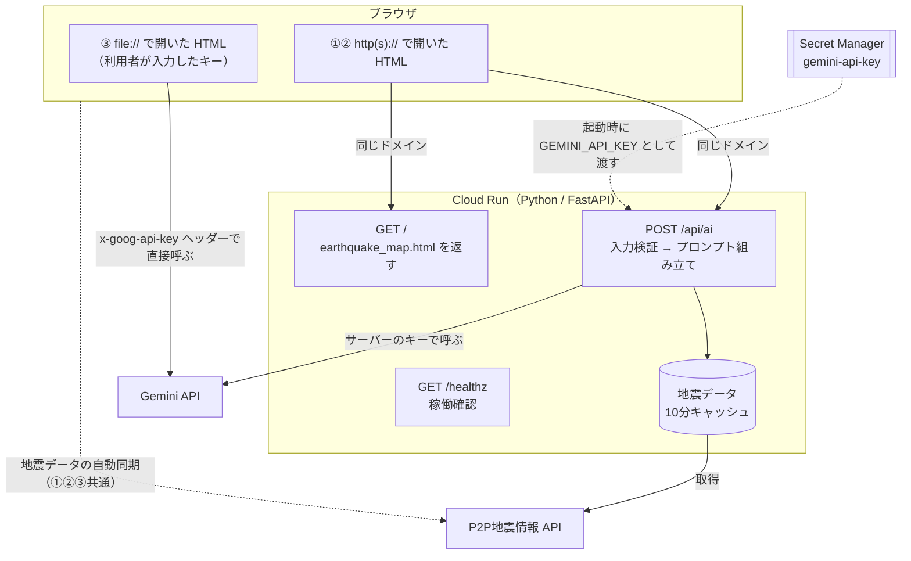
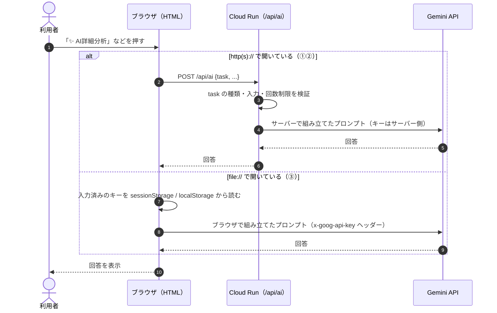

# アーキテクチャ設計: AI機能のサーバー化（Cloud Run + Secret Manager）

* ステータス: 実装済み・Cloud Run 未デプロイ（2026-11-12）
* 目的: Gemini APIキーをコードやブラウザに置かずに Cloud Run で公開し、ダウンロードした HTML でもローカルで使えるようにする

## 背景

変更前は `earthquake_map.html` の `callGeminiAPI` 内に `const apiKey = ""` があり、キーを書き込むとページを閲覧できる人は誰でもキーを読み取れる。公開にあたってキーを外部から参照できない構成にする。

## 利用形態

| 利用形態 | AI機能の流れ | APIキーの置き場所 |
| --- | --- | --- |
| ① Cloud Run 公開版 | ブラウザ → Cloud Run（Python）→ Gemini | Secret Manager（サーバーだけが読む） |
| ② ローカルでサーバー起動 | ①と同じ構成を手元で動かす | 手元の環境変数 `GEMINI_API_KEY` |
| ③ HTML を直接開く（`file://`） | ブラウザ → Gemini を直接呼ぶ | 利用者が画面で入力したキー（BYOK） |

地図、タイムライン、P2P地震情報との自動同期、ラベル表示などは3通りとも現状どおり動く。変わるのはAI機能の呼び出し方だけ。

## 構成図



HTML は開かれ方で動作を切り替える。



* `http(s)://`（①②）: `/api/ai` を呼ぶ。キー入力欄は表示しない。
* `file://`（③）: AIタブにキー入力欄を出し、Gemini を直接呼ぶ。

## サーバー API: `POST /api/ai`

受け付けるリクエストは次の3種類のみ。プロンプトはすべてサーバー側で組み立て、ブラウザから任意のプロンプトは送れない。

| task | ブラウザが送る内容 | サーバーの処理 |
| --- | --- | --- |
| `report` | なし | サーバーが取得した地震データ全体からレポートを生成 |
| `analyze` | 対象地震の情報（日時、震源、M、震度、緯度経度） | 型、文字数、数値範囲を検証してから分析 |
| `chat` | 質問文（500字まで） | 地震データを前提知識として回答 |

### 悪用・コスト対策

* 3種類以外のリクエストは拒否する。
* IP アドレスごとの回数制限（初期値: 1分に10回。超過時は HTTP 429）。
* 出力の上限（`maxOutputTokens`）と Gemini 呼び出しのタイムアウトを設ける。
* Cloud Run は `--min-instances 0 --max-instances 2` で起動する（下記「コスト管理」参照）。
* エラー時に利用者へ返すのは汎用メッセージのみ。詳細はサーバーログにだけ残す。

## コスト管理

### Cloud Run のインスタンス数

* `--min-instances 0`: アクセスがない間はインスタンスを0台にし、待機中の費用をかけない。
* `--max-instances 2`: アクセスが急増しても2台までに抑える。
* min-instances 0 の影響と対応:
  * しばらくアクセスがないと、次のアクセス時に起動待ち（コールドスタート、数秒程度）が発生する。
  * インスタンスが0台になると、メモリ上の地震データキャッシュと回数制限のカウントは消える。キャッシュは次のリクエストで取り直し、回数制限はリセットされる。いずれも動作上の問題はない。

### Spend Caps（支出上限）

Cloud Billing の「spend cap」タイプの予算を使い、月の支出が上限に達したらサービスの利用を自動で一時停止する。

* 上限は「1プロジェクト × 1サービス」ごとに設定するため、次の2つを別々に作る。

| 対象サービス | 上限に達したときの影響 | 方針 |
| --- | --- | --- |
| Gemini API（`generativelanguage.googleapis.com`） | AI機能だけが止まる。地図とタイムラインは使える | 有料枠なら**必ず設定する**（費用リスクの大部分）。無料枠なら料金がかからないため不要 |
| Cloud Run（`run.googleapis.com`） | サイト全体（HTML の配信を含む）が止まる | 設定する。少量アクセスでは上限に届きにくいが、異常なアクセスへの備えとする |

* 上限に達するとアラートメールが届く（50%、80%、100%）。停止は翌月の初めに自動で解除される。すぐ再開したいときは、予算画面で「Lift spend cap」を実行する（復旧まで最大1時間程度）。
* **厳密な上限ではない**: 費用の集計と停止には遅れがあり（Gemini API では10分前後）、超過分も請求される。上限は実際に許容できる額より少し低めにする。
* Secret Manager は spend cap の対象外。ただし費用はごく小さい。
* Gemini API には、Google AI Studio の「Spend」画面で設定するプロジェクト上限（Experimental）と、請求先アカウントの利用ティアごとの上限もある。Cloud Billing と AI Studio の両方で設定した場合は、先に達した方で止まる。設定は Cloud Billing 側に一本化する。
* 前払い（Prepay）や請求書払い（Invoiced）の請求先アカウントでは、挙動や利用可否が異なる。対象アカウントの種類を設定前に確認する。

### アプリ側の対応

* Gemini API が上限で止まると、サーバーへの応答がエラーになる。サーバーはこれを「AI機能は一時的に利用できません（今月の利用上限に達した可能性があります）」という利用者向けメッセージに変換して返す。
* 地図、タイムライン、P2P地震情報との同期は、Gemini API の停止とは関係なく動き続ける。

## ③ BYOK（ローカルで HTML を直接開く場合）

* AIタブに「Gemini APIキー」入力欄と、Google AI Studio でのキー取得方法を表示する。
* キーは `sessionStorage` に保存し、タブを閉じると消える。「このブラウザに保存する」をチェックした場合のみ `localStorage` に保存する。
* キーは URL に含めず `x-goog-api-key` ヘッダーで送る。
* 既存の `const apiKey = ""` は削除する。

## ファイル構成

```text
earthquake-map/
├── web/
│   └── earthquake_map.html  # 画面（AI呼び出しの切り替え、BYOK入力欄）。1ファイルで動く点は維持
├── server/
│   ├── main.py              # FastAPI（配信、/api/ai、地震データ取得、回数制限）
│   └── requirements.txt     # fastapi, uvicorn, httpx, google-genai
├── tests/
│   ├── test_server.py       # サーバーのスモークテスト（キー・ネットワーク不要）
│   ├── test_browser.py      # ブラウザのスモークテスト（Playwright、-m browser で実行）
│   └── requirements.txt     # テスト用（pytest, playwright）
├── .github/workflows/test.yml  # push / PR でサーバーのテストを自動実行
├── Dockerfile               # Cloud Run 用（web/ と server/ をまとめる）
├── pyproject.toml           # pytest の設定
├── .dockerignore
├── .gitignore               # .env などを除外
├── docs/architecture.md     # 本ドキュメント
├── README.md                # 使い方①②③、デプロイ手順、テストの実行方法
└── LICENSE
```

* 画面（`web/`）とサーバー（`server/`）をディレクトリで分け、役割を明確にする。HTML はダウンロードして直接開けるよう、ファイル名を `earthquake_map.html` のまま維持する。

* Gemini 呼び出しは公式 SDK `google-genai` を使う。

## Gemini の呼び出し方針

* **モデル**: 安定版の `gemini-3.5-flash-lite` に固定する（`GEMINI_MODEL`）。予備は `gemini-3.6-flash`（`GEMINI_FALLBACK_MODEL`）。選定の経緯は下記「モデル選定の診断結果」を参照。
* **考える深さ**: `LOW`（`GEMINI_THINKING_LEVEL`）。回答の速さを優先する。モデルによっては `MINIMAL` に非対応。
* **タイムアウト**: 1回の呼び出しにつき60秒（`GEMINI_TIMEOUT_MS`）。SDK はこの値を `X-Server-Timeout` ヘッダーで Gemini にも送るため、超えると Gemini 側で打ち切られる（504）。`file://` ではブラウザが60秒で通信を中断する。
* **再試行と予備のモデル**: 本来のモデルで最大2回、最後に予備のモデルで1回試す。予備を空にすると本来のモデルで最大3回試す。

| Gemini の応答 | 同じモデルで再試行 | 予備のモデル | 利用者への表示（最後まで失敗した場合） |
| --- | --- | --- | --- |
| 503（混雑） | する | 試す | 「AIが混み合っています」 |
| 500 などその他の 5xx | する | 試す | 汎用のメッセージ |
| 504（時間切れ） | しない（同じく時間切れになるため） | すぐ試す | 「時間がかかりすぎたため中断しました」 |
| 429（spend cap、無料枠の回数制限） | しない | 試さない | 「利用上限（回数または金額）に達しました」 |
| その他の 4xx（キーの誤りなど） | しない | 試さない | 汎用のメッセージ |

* **待ち時間の上限**: 最初の呼び出しから30秒（`RETRY_BUDGET_SECONDS`）を過ぎる場合は、同じモデルでは再試行しない。予備のモデルは必ず1回試す。最悪の待ち時間は約2分（60秒 × 2）。

### モデル選定の診断結果（2026-11-12、無料枠のキー）

最初は `gemini-flash-latest`、次に安定版の `gemini-3.8-flash` を使ったが、どちらも応答しなかった。原因を切り分けるため、本番と同じ Docker イメージの中から各モデルを直接呼んで計測した。

| モデル | 短い質問 | レポート（実際の使い方、考える深さ LOW） |
| --- | --- | --- |
| `gemini-3.8-flash` | 時間切れ（約88秒で 504。考える深さの指定の有無にかかわらず） | 時間切れ |
| `gemini-3.6-flash` | 5.6秒 | 36.5秒 |
| `gemini-3.5-flash-lite` | 1.1秒 | 5.1〜7.0秒 |

* `gemini-3.8-flash` はごく短い質問でも応答せず、プロンプトや設定ではなくモデルの提供側（混雑、または無料枠への割り当て）の問題と判断した。
* 速さと安定性から `gemini-3.5-flash-lite` を本来のモデルにし、応答はするが遅い `gemini-3.6-flash` を予備にした。
* SDK（google-genai 3.2.0）は考える深さを `thinking_level`（スネークケース）で送るが、API がこれを受け付けていることを確認した（思考トークン: `thinkingLevel=LOW` 785、`thinking_level=LOW` 515、`thinkingLevel=HIGH` 1,199）。
* `gemini-3.8-flash` が使えるようになった場合は、`GEMINI_MODEL` を変えるだけで切り替えられる。

## Gemini API の無料枠と有料枠

* 無料枠では、送信した内容（利用者の質問を含む）が Google の製品改善に使われる。有料枠では使われない。
* 無料枠には1分あたり・1日あたりの利用回数の上限がある（AI Studio の Rate limit 画面で確認）。超えると 429 が返る。
* Gemini のキーを発行したプロジェクトに請求先アカウントをつなぐと、自動で有料枠（Tier 1）になる。Cloud Run には請求先アカウントが必要なため、無料枠のまま使う場合は Gemini のキーを発行するプロジェクトを Cloud Run のプロジェクトと分ける。
* 一般公開の前に、無料枠と有料枠のどちらで運用するかを決める。無料枠で公開する場合は、利用者の入力が Google の製品改善に使われることを利用者に伝える。
* `file://` で開いた場合も、ブラウザが同じモデル、考える深さ、再試行の方針で Gemini を呼ぶ（値は HTML に定数として持つ）。
* 将来 Vertex AI に移行する場合は、SDK の初期化を `vertexai=True` に変え、サービスアカウントに `roles/aiplatform.user` を付与する。APIキーと Secret Manager は不要になる。

## デプロイ手順（概要）

1. `gcloud secrets create gemini-api-key --data-file=-` でキーを登録する。
2. Cloud Run 用の専用サービスアカウントを作り、`roles/secretmanager.secretAccessor` を付与する。
3. `gcloud run deploy --source . --set-secrets GEMINI_API_KEY=gemini-api-key:latest --min-instances 0 --max-instances 2 --allow-unauthenticated --service-account <SA>` でデプロイする。
4. Cloud Billing で spend cap タイプの予算を、Gemini API 用と Cloud Run 用に1つずつ作る（「コスト管理」参照）。

## トレードオフ・既知の制約

1. **プロンプトが2か所に分かれる**: ③では HTML が、①②では `server/main.py` がプロンプトを組み立てる。文面を変えるときは両方を直す。
2. **地震データ処理の重複**: サーバーも P2P地震情報 API から取得し、震度5弱以上・2026年以降で絞り込む。HTML と同じ条件を Python で再実装する。
3. **回数制限は簡易的**: インスタンスごとのメモリで数えるため、実際の上限は最大でインスタンス数倍になる。厳密にする場合は Firestore などに移す。

## 実装・検証の進め方

1. 作業用ブランチで実装する。
2. ②ローカルサーバーと③`file://` で動作確認する。
3. 確認内容をスモークテストとして残す。
   * サーバー（`tests/test_server.py`）: Gemini と P2P地震情報を偽物に置き換え、キーもネットワークも使わずに数秒で実行する。GitHub Actions で push / PR ごとに自動実行する。
   * ブラウザ（`tests/test_browser.py`）: Playwright で `http(s)://` と `file://` の切り替え、BYOK、HTML エスケープを確認する。Gemini への通信は横取りして偽の応答を返す。CDN の読み込みにインターネット接続が必要なため、`pytest -m browser` で明示的に実行する。
   * 本物の Gemini を呼ぶ確認は費用とキーが必要なため、自動テストに含めず手動で行う。
4. 確認後にコミットする。Cloud Run への実デプロイ（`gcloud` 実行）は利用者の Google Cloud プロジェクトで行うため、手順の案内までとする。
